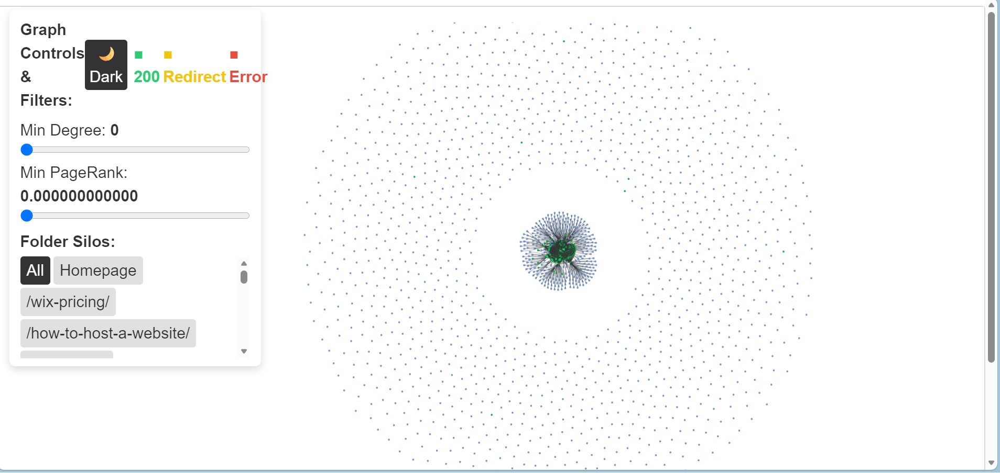

# 🕸️ WebAtlas: Interactive SEO Link Visualiser


[](https://pypi.org/project/networkx/)

[](https://pypi.org/project/openpyxl/)
[](https://pypi.org/project/pyvis/)


Interactive SEO Link Visualizer for Screaming Frog Exports.
WebAtlas is a Python-based technical SEO tool that transforms flat Screaming Frog Excel exports into dynamic, interactive network graphs. It allows SEOs to visualize internal linking structures, identify crawl depth issues, and discover topical silos that are invisible in standard spreadsheets.

---

## 📸 Screenshot of the SEO Link Visualiser

- Status Color Breakdown:

- Green Nodes: The vast majority of the dots are green, representing healthy pages returning a 200 OK status code.

- Red Nodes: A scattering of red dots is mixed throughout the structure, pinpointing specific pages with HTTP errors (such as 404 or 500 errors).

- Min Degree Slider: Dynamically reveals or hides graph complexity by filtering out low-connectivity nodes below a chosen threshold.

- Min PageRank Slider: Non-linearly filters pages by authority using a high-resolution scale to isolate high-value link hubs.

- Folder Silos: Groups URLs by directory structure, allowing instant filtering to specific site sections.



---

## 🚀 The Core Problem & Solution

- The "Graphviz Nightmare"Initially, this project attempted to use Graphviz (the industry standard for diagramming). However, I encountered a major hurdle:
- Graphviz is designed for Hierarchical Trees (like org charts).
- Websites are Non-Linear Networks (where any page can link to any other page).
When Graphviz tries to force a website into a tree structure, it results in an "infinite vertical strip" that is impossible to read or navigate.
- The "PyVis" Evolution
I pivoted to NetworkX (for the mathematical graph logic) and PyVis (for the browser-based visualization).
- Physics-Based Layout: Instead of a static image, I now have a "force-directed" graph. Nodes push each other away until they find space, naturally "untangling" the website's structure.
- Interactivity: Users can zoom, use sliders, highlight URLs, drag nodes, and hover over elements to see hidden metadata.

---

## ✨ Key Features
- Interactive Hover Tooltips: Nodes are labeled with short, clean URLs (slugs), but hovering over them reveals the full URL and the exact XPath/Link Position where the link was found.
- Noise Reduction: Automatically filters out non-hyperlinks (Images, CSS, JS, etc.) to focus specifically on the "Internal Link Ecosystem.
- Performance Optimized: Uses the Barnes-Hut physics engine and stabilization iterations to ensure that even large sites (the "Mothball" effect) load quickly in the browser.
- Dark Mode toggle Visualization: Designed with a high-contrast dark theme for better visibility of complex link paths.

---

## 🛠️ Installation
Ensure you have Python 3.10+ installed.

### Clone the repository:
```Bash
git clone https://github.com/reory/web-atlas.git
cd web-atlas
```
### Install dependencies:
```Bash
pip install pyvis networkx openpyxl
```

---

## 📂 Usage
- To generate your interactive map, you need two exports from Screaming Frog (XLSX format):Internal (All HTML pages)All Outlinks (The massive list of every link found)

### Run the following command:
PowerShell
```bash
python main.py --xlsx internal.xlsx All_Outlinks.xlsx atlas.html
```
- Open atlas.html in any modern web browser to explore your site's architecture.

---

## Tech Stack

* **PyVis** is a Python library built specifically for creating interactive network graphs that run in a web browser.
* **Networkx** Performs advanced SEO analysis, such as identifying "Orphan Pages" (nodes with no incoming edges) or calculating "PageRank" to see which pages hold the most authority.
* **OpenPyxl** is a library used to read and write Excel (.xlsx) files.

---

## 📁 Project Structure
```
web-atlas/
├── webatlas/                 # Core package
│   ├── __init__.py
│   ├── sf_import.py          # Screaming Frog XLSX importer
│   ├── graph_builder/        # NetworkX graph construction + SEO logic 
|       ├── builder.py
|       ├── constants.py
|       ├── html_injector.py
|       ├── network_ops.py
|       ├── pyvis_config.py
│
├── lib/                      # Additional assets or helper modules
│   └── ...                   
│
├── tests/                    # Pytest suite
│   ├── test_builder.py
|   ├── test_html_injector.py
|   ├── test_network_ops.py
|   ├── test_sf_imports.py
├── main.py                   # CLI entry point
├── README.md                 # Project documentation
├── CONTRIBUTING.md           # Contribution guidelines
├── LICENSE.md                # MIT license
├── requirements.txt          # Python dependencies
├── pyproject.toml            # Build + metadata config
├── pytest.ini                # Config file for pytest
```

---

## 🧠 Why this Architecture?
- Component Why I chose it
- Openpyxl Allows us to read massive Excel files directly without needing a database
- NetworkX The "brain" of the project. It handles the complex math of linking thousands of nodes.
- PyVis The "beauty." It turns the math into an interactive HTML/JavaScript experience that runs in any browser.

---

## 🕵️‍♂️ How to Read the "Mothball"
- When you first open your graph, you might see a dense cluster (a "mothball"). Here’s how to audit it:
- The Core: The center of the ball usually contains your Header and Footer links.
- The Planets: Small clusters orbiting the main ball are often your Blog categories or Service silos.
- The Drifters: Nodes floating far away with only one connection are "Deep Pages" or near-orphans that need better internal linking to rank.
- Built for SEOs who want to see their data, not just read it.

---

## 🧪 Tests
- The project includes a Pytest suite to validate graph initialization and data integrity. 
- Run 
```bash
pytest
```
tests/ to ensure the "mothball" logic and XPath mapping are functioning correctly before deployment.

---

## 🛣️ Roadmap Features

- [x] **Status Code Color-Coding:**  
  Color pages by HTTP status to highlight site health issues at a glance.

- [x] **PageRank Node Scaling:**  
  Scale node size using NetworkX PageRank to emphasize structurally important pages.

- [x] **Folder Silo Grouping:**  
  Group URLs by folder structure and provide interactive silo filtering.

- [x] **Interactive Graph Density Filters:**  
  Add Degree and PageRank sliders to dynamically reveal or hide graph complexity.

- [x] **Dark Mode Toggle:**  
  Provide a clean UI toggle to switch the graph canvas and toolbar background between Light and Dark themes.

- [ ] **External Template Refactoring:**  
  Extract inline JavaScript and HTML toolbar strings into dedicated template files to improve syntax highlighting, linting, and maintainability.

- [ ] **Temporal Crawl Diffing ("Time-Travel"):**  
  Compare two crawls to visualize new, removed, and changed pages over time.

- [ ] **Interactive Pathfinding & Bottleneck Analysis:**  
  Highlight shortest paths, redirect chains, orphan pages, and structural bottlenecks.

- [ ] **ML-Powered Architectural Anomaly Detection:**  
  Use Isolation Forest models to surface unusual pages, clusters, and linking patterns.

---

* **Built by Roy Peters** 😁
[](https://linkedin.com/in/roy-p-74980b382/)